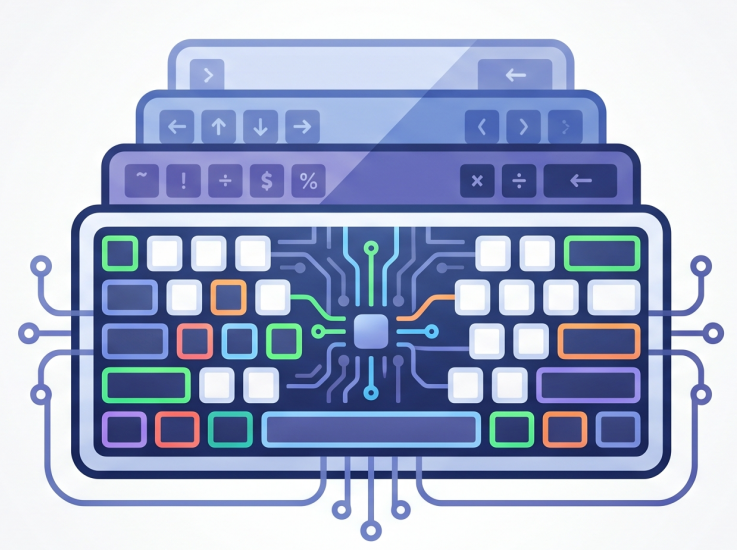

<p align="center">
  
</p>

# keymapgen

**keymapgen** is a web-based, visual keyboard configuration tool that allows you to intuitively remap your keyboard, define multiple layers, and export the resulting configuration to either [keyd](https://github.com/rvaiya/keyd) (`.conf`) or AutoHotkey (`.ahk`) formats.

## Features
- **Visual Interface:** Map keys directly on a virtual keyboard layout.
- **Multi-Layer Support:** Create multiple custom layers (e.g., `main`, `nav`, `sym`, `shift:S`) and easily switch between them in the UI.
- **Bi-Directional Parsing:** Load your existing `.conf` or `.ahk` configurations directly into the tool to edit them visually.
- **Dual Export:** Export your mappings with a single click to `.conf` or `.ahk` formats.
- **Layout Variations:** Toggle between different physical layouts (e.g., standard EN vs DE ISO).

## How to Use the UI Tool

1. **Load Configuration:** Click **Load Config** to either paste your existing configuration text or upload a `.conf` / `.ahk` file.
2. **Select Layers:** Use the layer tabs (e.g., `main`, `nav`) at the top to switch the layer you are currently editing.
3. **Map Keys:** Click on any key on the visual keyboard representation. In the right-hand panel, define the action or mapping for that key (e.g., `C-c` for Copy, `layer(nav)` to trigger a layer).
4. **Manage Layers:** You can Rename, Remove, or Add new layers using the buttons in the layer bar.
5. **Export Configuration:** Click **Export Config** to generate the final script. Choose between Keyd or AHK format and download or copy the resulting code.

## Examples

In the `examples/` directory, you can find the `famak` configuration. This is a custom keyboard layout I created and use every day. It is an English-German layered and modified version of the angle-mod wide ISO [Colemak-DH layout](https://colemakmods.github.io/mod-dh/) inspired by the [3l layout](https://github.com/jackrosenthal/threelayout). Additional standard examples for Colemak and Dvorak are also provided.

## Development

Install dependencies and run the development server:

```bash
npm install
npm run dev
```

Build for production:

```bash
npm run build
```
